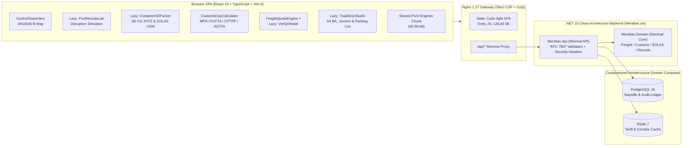

# MERIDIAN v3.0 — Global Freight Control Tower & `.NET 10` Customs Monorepo

[](https://tvt987.github.io/meridian-logistics/)
[](./backend/Meridian.sln)
[](#verification--benchmarks)
[](#verification--benchmarks)
[](./docs/openapi.yaml)

**Meridian Logistics v3.0** is a full-stack global freight control tower, multimodal disruption simulator, 3D SOLAS VGM container balance auditor, and Vietnam HS Code / FTA landed-cost platform built with **React 19 + TypeScript + Tailwind CSS v4** and a **Clean Architecture `.NET 10` Minimal API** (`Meridian.Domain` + `Meridian.Api`).

---

## System Architecture



---

## Flagship Capabilities (v3.0)

| Module | Engineering Highlights |
| :--- | :--- |
| **Port Disruption & Multimodal Reroute Simulator** | Multi-toggle live shocks (**Red Sea / Suez Transit Closure +12d**, **Cat Lai Peak-Season Congestion +4d**, **US West Coast Port Strike +9d**) comparing **Ocean Direct** vs **Sea-Air Hybrid (Dubai DXB / Singapore SIN)** vs **Direct Air Freight (B777F)** on Lead Time, Total Landed Cost (USD/VND), Working Capital Carry (18% WACC) + SLA Breach Penalty, `kg CO2e` Carbon Intensity, and 0–100 Resilience Score. |
| **3D Container Stuffing & SOLAS VGM Axle Audit** | Isometric 3D + Orthographic Side (`L x H`) & Top (`L x W`) cargo bay visualizer across ISO `20'GP`, `40'GP`, `40'HC`, and `40'RF` containers with **3-Axis Center-of-Gravity (`CG-X / CG-Y / CG-Z %`)**, **Kingpin vs Rear Tandem Axle Weight Split**, **SOLAS Chapter VI e-VGM Gross Mass**, and explicit `SOLAS VGM PASS / FAIL` compliance gate. |
| **Vietnam HS Code & FTA Landed-Cost Engine** | Exact Vietnam Customs CIF valuation (`FOB + Freight + Insurance`) with cascading `Import Duty -> Special Consumption Tax (TTDB) -> Import VAT (8% / 10%)` comparing **MFN vs EVFTA (EUR.1/REX) vs CPTPP vs ACFTA (Form E)** and highlighting optimal C/O savings. |
| **Volumetric Freight Quoter & MBBank VietQR** | IATA Air Express (`6000`), Air Standard (`5000`), Road (`4000`), Sea LCL W/M (`1000`), and FCL `20ft/40ft` pricing with Incoterms 2020 (`FOB / CIF / DDP`), active reefer telemetry, persistent localStorage Shipment Vault, UTF-8 BOM CSV manifest export, MBBank NAPAS 247 VietQR deposits, and printable **A4 Bill of Lading, Commercial Invoice & Packing List**. |
| **`.NET 10` Clean Architecture Backend** | Compiled `.NET 10` solution (`backend/Meridian.sln`) with decimal financial precision, RFC 7807 `ValidationProblemDetails`, strict security headers, OpenAPI 3.1 contract, and 22 xUnit + `WebApplicationFactory<Program>` integration tests. |

---

## `.NET 10` API Endpoints

Full OpenAPI 3.1 specification: [`docs/openapi.yaml`](./docs/openapi.yaml)

| Method | Endpoint | Purpose |
| :--- | :--- | :--- |
| `GET` | `/health` | Service readiness, `.NET 10` runtime telemetry, and loaded domain catalog counts |
| `POST` | `/api/v1/quotes/freight` | IATA volumetric (`6000`/`5000`), W/M LCL & FCL freight quote with Incoterms 2020 & CO2e |
| `POST` | `/api/v1/customs/landed-cost` | Vietnam HS Code CIF valuation, cascading Duty/SCT/VAT, and 4-regime FTA savings matrix |
| `POST` | `/api/v1/containers/balance-check` | 3D bin-packing, `CG X/Y/Z %`, axle weight distribution, and SOLAS e-VGM pass/fail audit |
| `POST` | `/api/v1/corridors/reroute` | Port disruption simulation & Ocean vs Sea-Air (DXB/SIN) vs Air SLA resilience optimization |

---

## Architecture Decision Records (ADRs)

- [`docs/ADR-001-ChargeableWeight-EVFTA-Customs-Engine.md`](./docs/ADR-001-ChargeableWeight-EVFTA-Customs-Engine.md) — Dual-parity TypeScript & `.NET 10` decimal financial arithmetic for IATA volumetric pricing and Vietnam cascading Duty/SCT/VAT across MFN/EVFTA/CPTPP/ACFTA.
- [`docs/ADR-002-Container-SOLAS-VGM-Balance.md`](./docs/ADR-002-Container-SOLAS-VGM-Balance.md) — 3D bay-column stuffing heuristic, 3-axis mass centroid (`CG X/Y/Z %`), axle beam reactions, and SOLAS Chapter VI e-VGM compliance gate.

---

## Quick Start

### 1. Full-Stack Docker Compose (Frontend + `.NET 10` API + PostgreSQL 16 + Redis 7)

```bash
docker compose up --build -d
# Web Control Tower (Nginx + SPA + /api proxy): http://localhost:8080
# .NET 10 API Health:                            http://localhost:5080/health
```

### 2. Local Development (Frontend & `.NET 10` Backend)

```bash
# Frontend (Node 22+)
npm ci
npm run dev           # http://localhost:5173
npm test              # 85 Vitest unit tests
npm run build         # Type-check + code-split Vite production bundle

# Backend (.NET 10 SDK)
dotnet test backend/Meridian.sln     # 22 xUnit + WebApplicationFactory tests
dotnet run --project backend/src/Meridian.Api
```

---

## Verification & Benchmarks

| Verification Gate | Tooling | Result |
| :--- | :--- | :--- |
| **Frontend Unit Tests** | Vitest 3.2.7 (`npm test`) | **85 / 85 passed** (5 test suites, ~1s) |
| **Backend Integration Tests** | `.NET 10.0.401` xUnit + `WebApplicationFactory<Program>` (`dotnet test backend/Meridian.sln`) | **22 / 22 passed** (`0` warnings, `0` errors) |
| **Frontend Bundle Splitting** | Vite 6 + `React.lazy` + `manualChunks` (`npm run build`) | Entry JS `126.84 kB` (`29.87 kB` gzip) · `engines` `65.58 kB` · Lazy chunks: `Container3DPacker` `26.06 kB`, `TradeDocStudio` `24.09 kB`, `PortRerouteLab` `18.24 kB`, `VietQrModal` `9.75 kB`, `qrcode` `25.39 kB` |
| **Headless E2E Audit** | Playwright Chromium (`1440x900` Desktop + `390x844` Mobile) | **0** console errors · **0** page errors · **0** failed requests · **0px** horizontal overflow · Live disruption toggles & SOLAS CG X/Y/Z verified |
| **Security Posture** | Strict CSP, `Referrer-Policy: strict-origin-when-cross-origin`, `X-Content-Type-Options: nosniff` | Zero `dangerouslySetInnerHTML`, zero `innerHTML`, zero `eval`, zero custom cursors, zero UI emojis |

---

Engineered by **Truong Van Tinh** — Solution Architect & Full-Stack `.NET` / React Engineer ([github.com/tvt987](https://github.com/tvt987) · `tinhkun102@gmail.com`).
