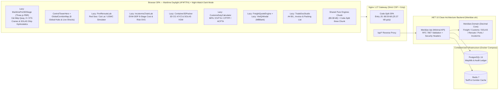

# MERIDIAN v5.0 — 60fps 3D Deep-Water Container Port, Articulated STS Gantry Crane & Maritime Control Tower

[](https://tvt987.github.io/meridian-logistics/)
[](./backend/Meridian.sln)
[](#verification--benchmarks)
[](#verification--benchmarks)
[](./docs/openapi.yaml)

**Meridian Logistics v5.0** is a full-stack **60fps Three.js PBR Deep-Water Container Port & Articulated Ship-to-Shore (STS) Gantry Crane Digital Twin**, **Flexport / Maersk Daylight Maritime Control Tower**, animated global sea-lane & air-corridor map, interactive **Incoterms 2020** cost-and-risk transfer visualizer, 3D **SOLAS VGM** container balance auditor, and Vietnam HS Code / FTA landed-cost platform built with **React 19 + TypeScript + Three.js PBR + Tailwind CSS v4** and a **Clean Architecture `.NET 10` Minimal API** (`Meridian.Domain` + `Meridian.Api`).

---

## System Architecture



---

## Flagship Capabilities (v5.0)

| Module | Engineering Highlights |
| :--- | :--- |
| **60fps 3D Deep-Water Port & Articulated STS Gantry Crane Twin** | Above-the-fold **Three.js PBR** deep-water quay (*Cái Mép – Thị Vải* Berth CM-04) with glistening animated harbor waves, concrete apron & container yard stacks, sculpted 14,000-TEU `MV MERIDIAN VANGUARD` vessel (red bulbous bow, white Plimsoll waterline, 5-deck bridge with rotating X-band radar), and **2 towering Vermilion/Orange Ship-to-Shore (STS) Gantry Cranes** running an 8-phase kinematic hoist state machine (`IDLE -> SLEW_TO_QUAY -> LOWER_SPREADER -> LATCH -> HOIST -> TROLLEY_OVER_BAY -> PLACE_ON_SHIP -> RETURN`). Features direct 3D raycast bay clicking, live hydrostatic **SOLAS VGM / 3D CG / Metacentric Height `GM` / Heel `°` / Trim `°`** physics + SVG inclinometer, `INJECT STARBOARD IMBALANCE` (`> 6.5°` `SOLAS CRITICAL`), `AUTO-TRIM BALLAST & STOW` optimizer (`< 0.5°`, `GM > 1.8m`), `SUEZ STORM SEA` wave toggle, and 3 damped camera presets. |
| **Flexport / Maersk Maritime Daylight Control Tower** | Ice-White Maritime Daylight default boot theme (`#F4F7FA` canvas, `#FFFFFF` structured cards, `#0F2942` Deep Maritime Navy ink, `#0284C7` Ocean Signal Blue, `#D97706` Container Amber) with crisp tabular monospace figures and a live **Night-Watch Dark Mode** toggle in the header. |
| **Hero Animated Global Sea-Lane & Air-Corridor SVG Map** | Cartographic world chart plotting 8 global trade hubs (**Cat Lai HCMC**, **Hai Phong**, **Singapore SIN**, **Dubai DXB**, **Suez Canal**, **Cape of Good Hope**, **Rotterdam RTM**, **Los Angeles LAX**). Renders animated curved lanes (`Ocean Direct`, `Cape Reroute +12d`, `Sea-Air Hybrid via DXB/SIN`, `Direct Air Freight`) with live moving vessel/aircraft markers, glowing disruption zones synchronized live with the Reroute Lab, and clickable port telemetry inspection (dwell hours, berth congestion %, annual & daily TEU). |
| **Incoterms 2020 Cost & Risk Transfer Chain Visualizer** | Interactive 8-stage horizontal SVG handover matrix comparing all 7 core **Incoterms 2020** (`EXW`, `FCA`, `FOB`, `CFR`, `CIF`, `DAP`, `DDP`) across *Factory Gate -> Origin Inland -> Export Customs -> Port Loading -> Main Freight -> Marine Insurance -> Import Customs/EVFTA Duty -> Buyer Warehouse* with exact USD/VND Seller vs Buyer allocation, C-term Cost/Risk Split Point pins, mandatory ICC (C) insurance badges, and legal compliance warnings. |
| **Port Disruption & Multimodal Reroute Simulator** | Multi-toggle live shocks (**Red Sea / Suez Transit Closure +12d**, **Cat Lai Congestion +4d**, **USWC Port Strike +9d**) synchronized with the Hero SVG Map, comparing **Ocean Direct** vs **Sea-Air Hybrid (DXB / SIN)** vs **Direct Air Freight (B777F)** on Lead Time, Total Landed Cost, Working Capital Carry + SLA Penalty, `kg CO2e`, and 0–100 Resilience Score. |
| **3D Container Stuffing & SOLAS VGM Axle Audit** | Isometric 3D + Orthographic Side (`L x H`) & Top (`L x W`) cargo bay visualizer across ISO `20'GP`, `40'GP`, `40'HC`, and `40'RF` containers with **3-Axis Center-of-Gravity (`CG-X / CG-Y / CG-Z %`)**, **Kingpin vs Rear Tandem Axle Split**, **SOLAS e-VGM Gross Mass**, and explicit `PASS / FAIL` compliance gate. |
| **Vietnam HS/FTA Customs, Freight Quoter & MBBank VietQR** | Exact Vietnam CIF valuation with cascading `Import Duty -> SCT (TTDB) -> Import VAT (8% / 10%)` across **MFN / EVFTA / CPTPP / ACFTA**, IATA volumetric (`6000`/`5000`) & FCL/LCL pricing, persistent localStorage Shipment Vault, UTF-8 BOM CSV export, MBBank NAPAS 247 VietQR deposits, and printable **A4 Bill of Lading, Commercial Invoice & Packing List**. |
| **`.NET 10` Clean Architecture Backend** | Compiled `.NET 10` solution (`backend/Meridian.sln`) with decimal financial precision, RFC 7807 `ValidationProblemDetails`, strict security headers, OpenAPI 3.1 contract, and 34 xUnit + `WebApplicationFactory<Program>` integration tests (`0` warnings). |

---

## `.NET 10` API Endpoints

Full OpenAPI 3.1 specification: [`docs/openapi.yaml`](./docs/openapi.yaml)

| Method | Endpoint | Purpose |
| :--- | :--- | :--- |
| `GET` | `/health` | Service readiness, `.NET 10` runtime telemetry, and loaded domain catalog counts |
| `GET` | `/api/v1/corridors/ports` | Live global port congestion telemetry (8 hubs), dwell hours, TEU throughput & active corridor statuses (`?disruptions=...`) |
| `POST` | `/api/v1/incoterms/allocate` | Exact Seller vs Buyer cost split, mandatory insurance rule & risk transfer stage across all 7 Incoterms 2020 (`EXW`–`DDP`) |
| `POST` | `/api/v1/quotes/freight` | IATA volumetric (`6000`/`5000`), W/M LCL & FCL freight quote with Incoterms 2020 & CO2e |
| `POST` | `/api/v1/customs/landed-cost` | Vietnam HS Code CIF valuation, cascading Duty/SCT/VAT, and 4-regime FTA savings matrix |
| `POST` | `/api/v1/containers/balance-check` | 3D bin-packing, `CG X/Y/Z %`, axle weight distribution, and SOLAS e-VGM pass/fail audit |
| `POST` | `/api/v1/corridors/reroute` | Port disruption simulation & Ocean vs Sea-Air (DXB/SIN) vs Air SLA resilience optimization |

---

## Architecture Decision Records (ADRs)

- [`docs/ADR-001-ChargeableWeight-EVFTA-Customs-Engine.md`](./docs/ADR-001-ChargeableWeight-EVFTA-Customs-Engine.md) — Dual-parity TypeScript & `.NET 10` decimal financial arithmetic for IATA volumetric pricing and Vietnam cascading Duty/SCT/VAT across MFN/EVFTA/CPTPP/ACFTA.
- [`docs/ADR-002-Container-SOLAS-VGM-Balance.md`](./docs/ADR-002-Container-SOLAS-VGM-Balance.md) — 3D bay-column stuffing heuristic, 3-axis mass centroid (`CG X/Y/Z %`), axle beam reactions, and SOLAS Chapter VI e-VGM compliance gate.

---

## Quick Start

### 1. Full-Stack Docker Compose (Frontend + `.NET 10` API + PostgreSQL 16 + Redis 7)

```bash
docker compose up --build -d
# Web Control Tower (Nginx + SPA + /api proxy): http://localhost:8080
# .NET 10 API Health:                            http://localhost:5080/health
```

### 2. Local Development (Frontend & `.NET 10` Backend)

```bash
# Frontend (Node 22+)
npm ci
npm run dev           # http://localhost:5173
npm test              # 143 Vitest unit tests
npm run build         # Type-check + code-split Vite production bundle

# Backend (.NET 10 SDK)
dotnet test backend/Meridian.sln     # 34 xUnit + WebApplicationFactory tests
dotnet run --project backend/src/Meridian.Api
```

---

## Verification & Benchmarks

| Verification Gate | Tooling | Result |
| :--- | :--- | :--- |
| **Frontend Unit Tests** | Vitest 3.2.7 (`npm test`) | **143 / 143 passed** (8 test suites including 32 deterministic hydrostatic SOLAS & STS crane tests) |
| **Backend Integration Tests** | `.NET 10` xUnit + `WebApplicationFactory<Program>` (`dotnet test backend/Meridian.sln`) | **34 / 34 passed** (`0` warnings, `0` errors) |
| **Frontend Bundle Splitting** | Vite 6 + `React.lazy` + `manualChunks` (`npm run build`) | Entry JS **`88.59 kB`** (`25.37 kB` gzip) · `engines` `89.08 kB` · Lazy chunks: `MaritimePort3DStage` `53.67 kB`, `three` `559.62 kB`, `Container3DPacker` `26.06 kB`, `TradeDocStudio` `24.09 kB`, `PortRerouteLab` `18.22 kB`, `FreightQuoteEngine` `16.77 kB`, `CustomsDutyCalculator` `16.58 kB`, `IncotermsChainLab` `16.15 kB`, `WaybillTrackerSection` `13.33 kB`, `VietQrModal` `9.75 kB`, `qrcode` `25.39 kB` |
| **Headless E2E Audit** | Playwright Chromium (`1440x900` Desktop + `390x844` Mobile) | **0** console errors · **0** page errors · **0** failed requests · **0px** horizontal overflow · Verified live 3D PBR Port Hero (`0.0°` NOMINAL), Starboard Imbalance (`+7.9°` `SOLAS CRITICAL`), Auto-Trim (`0.0°`, `GM 2.98m`) + mid-air `STS-02 · TROLLEY_OVER_BAY` Reefer hoist, Suez Storm Sea, 3 camera presets, and Mobile 390px layout |
| **Security Posture** | Strict CSP, `Referrer-Policy: strict-origin-when-cross-origin`, `X-Content-Type-Options: nosniff` | Zero `dangerouslySetInnerHTML`, zero `innerHTML`, zero `eval`, zero custom cursors, zero UI emojis |

---

Engineered by **Truong Van Tinh** — Solution Architect & Full-Stack `.NET` / React Engineer ([github.com/tvt987](https://github.com/tvt987) · `tinhkun102@gmail.com`).
